# QR-Based Cafe Ordering System

A full-stack QR-based cafe ordering system built for a local cafe pilot, with customer ordering and owner management workflows.

## Status

QR Cafe was built and deployed for a 2--3 month local cafe pilot and served 100+ customers. The original production domain is no longer active because the cafe later returned to manual order management. The source code remains available for review, and the app can be run locally for demo purposes.

## Pilot Learning

The main adoption issue was operational rather than purely technical: the cafe owner did not have a convenient dedicated device/process to manage incoming orders, so they eventually returned to manual ordering. This shaped later fixes around owner-side payment confirmation and safer operational workflows.

## Recent Hardening Fixes

- Removed unsafe default owner credential behavior.
- Changed UPI payment flow so customer submission remains pending until owner confirmation.
- Updated owner dashboard wording from “Verify Payment” to “Confirm Payment Received”.

## Project Structure

```text
.
├── backend/                 # Node.js + Express + MongoDB API
├── frontend-customer/       # Customer-facing React app
├── frontend-owner/          # Owner dashboard React app
└── docs/screenshots/        # Customer and owner UI screenshots
```

## Screenshots

### Customer Flow

#### Login
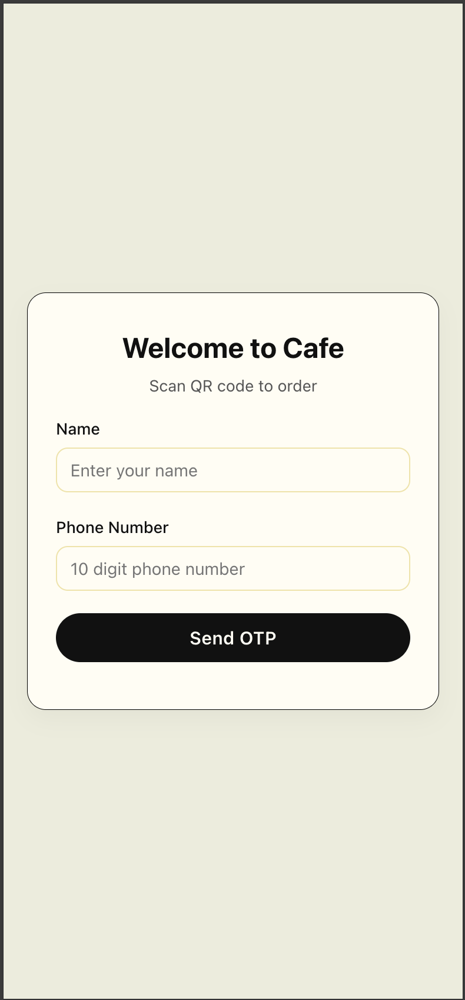

#### Menu
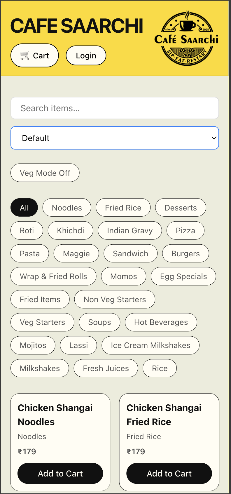

#### Cart
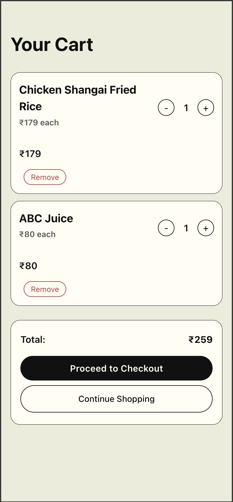

#### Checkout
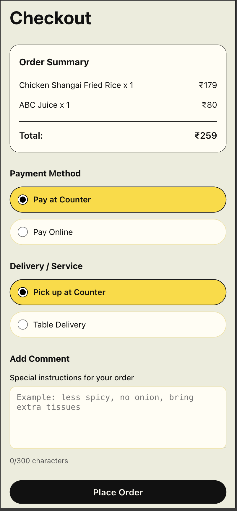

#### Order Confirmation
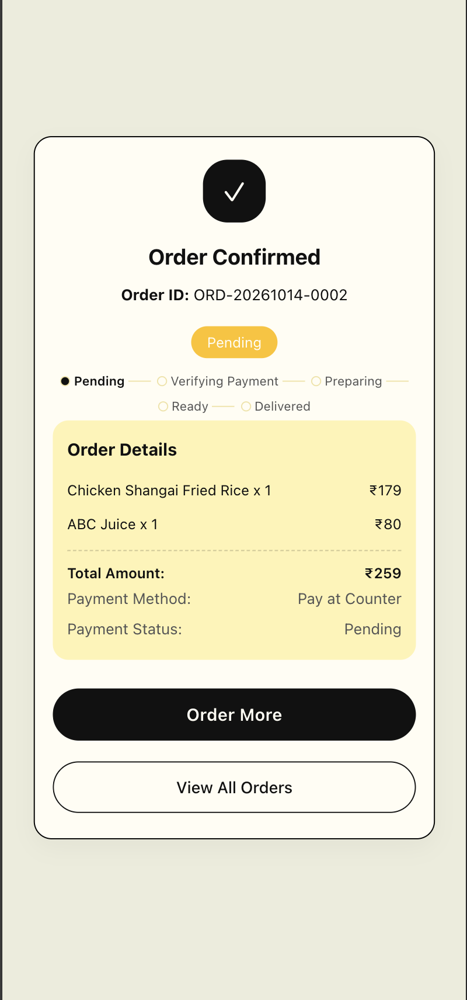

#### My Orders
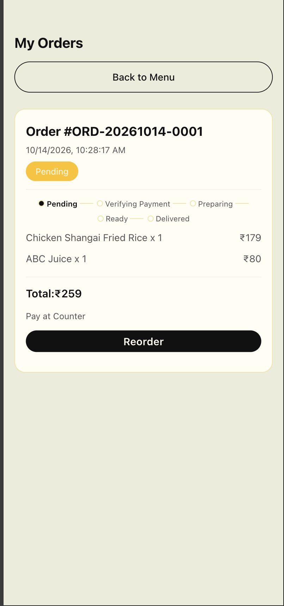

### Owner Flow

#### Login
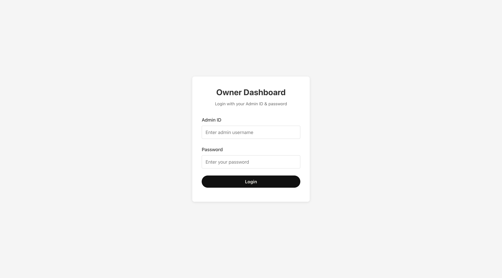

#### Dashboard
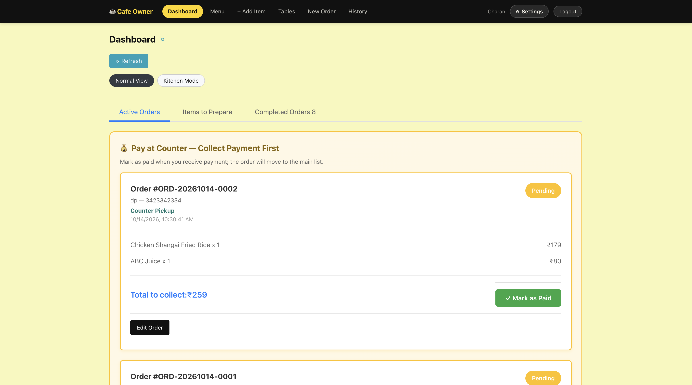

#### Menu Management
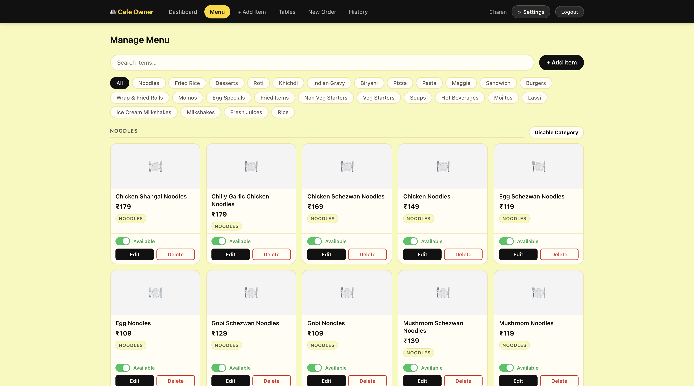

#### Add Item
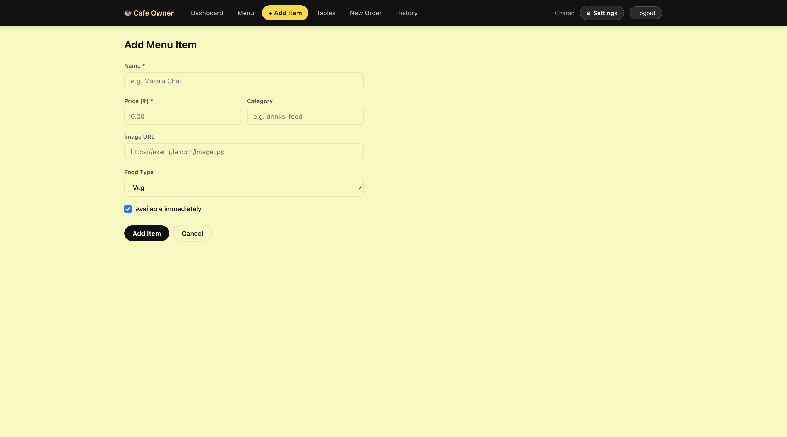

#### Manual Order
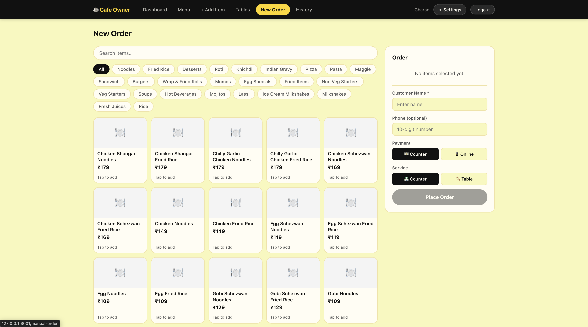

#### Table Management
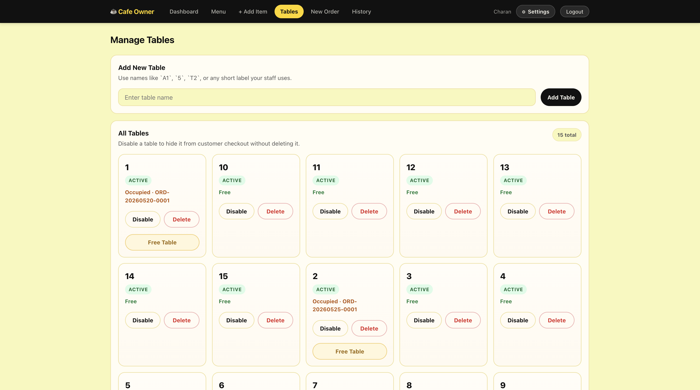

#### Order History
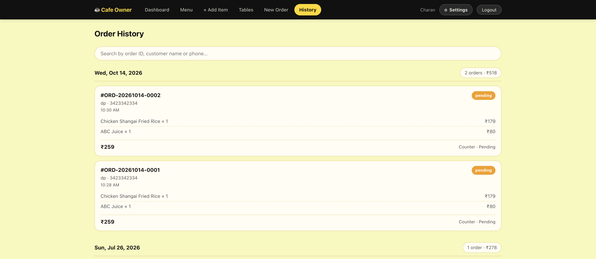

#### Settings
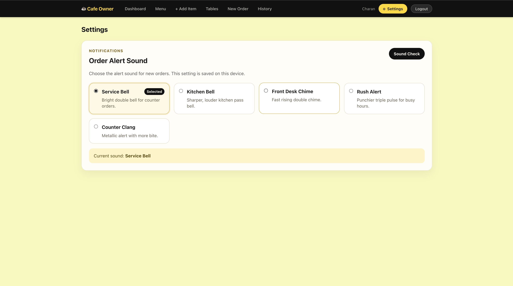

## Quick Start

### Prerequisites

- Node.js 24.x, matching the package `engines` field
- MongoDB Atlas or local MongoDB
- npm

### Backend Setup

```bash
cd backend
npm install
cp .env.example .env
```

Update `backend/.env`:

```env
MONGO_URI=your-mongodb-connection-string
JWT_SECRET=your-secret-key-min-32-chars
PORT=5000
NODE_ENV=development
ENABLE_PAYMENT=true
```

Start the backend:

```bash
npm run dev
```

Backend runs on `http://localhost:5000` when `PORT=5000` is set.

### Customer Frontend Setup

```bash
cd frontend-customer
npm install
cp .env.example .env
npm run dev
```

Use this local env:

```env
VITE_API_URL=http://localhost:5000
VITE_ENABLE_PAYMENT=true
VITE_UPI_ID=cafe@upi
VITE_CAFE_NAME=Cafe%20Saarchi
```

Customer app runs on `http://localhost:3000`.

### Owner Frontend Setup

```bash
cd frontend-owner
npm install
cp .env.example .env
npm run dev
```

Use this local env:

```env
VITE_API_URL=http://localhost:5000
VITE_ENABLE_PAYMENT=true
```

Owner app runs on `http://localhost:3001`.

## Authentication

### Customer OTP

Customers log in with name, phone number, and OTP.

OTP delivery is controlled by `SMS_PROVIDER`:

- `mock`: logs OTP in backend console; development only
- `website`: returns OTP in API response so the website can display it; demo only
- `fast2sms`: sends OTP via Fast2SMS

Generated OTPs expire after 10 minutes.

### Owner Account Setup

Default owner creation is disabled unless explicitly enabled.

To bootstrap an owner locally, set these in `backend/.env`:

```env
CREATE_DEFAULT_OWNER=true
DEFAULT_OWNER_PHONE=your-owner-phone
DEFAULT_OWNER_PASSWORD=your-strong-password
DEFAULT_OWNER_NAME=Cafe Owner
DEFAULT_OWNER_USERNAME=owner
```

Then start the backend once. Do not use weak credentials in production. The password is not logged.

## API Endpoints

### Public

- `GET /api/menu` - Get all menu items
- `GET /api/menu?available=true` - Get only available items
- `POST /api/auth/request-otp` - Request OTP
- `POST /api/auth/verify-otp` - Verify OTP and login

### Customer Protected

- `POST /api/orders` - Create new order
- `GET /api/orders/my` - Get customer's orders
- `GET /api/orders/:id` - Get order details
- `PATCH /api/orders/:id/customer-paid` - Submit online payment claim for owner verification

### Owner Protected

- `GET /api/orders` - Get all orders
- `PATCH /api/orders/:id/status` - Update order status
- `PATCH /api/orders/:id/payment` - Mark payment as received
- `POST /api/orders/manual` - Create manual order
- `POST /api/menu` - Add menu item
- `PUT /api/menu/:id` - Update menu item
- `PATCH /api/menu/:id/availability` - Toggle item availability
- `GET /api/tables/all` - Manage tables

## Database Models

### User

- `name`
- `phone`
- `role`: `customer` or `owner`
- `username` and `password` for owner login
- `otp`: code and expiry for customer login

### Menu

- `name`
- `price`
- `available`
- `category`
- `imageUrl`
- `isVeg`
- `displayOrder`

### Order

- `orderId`
- `customer`
- `items`
- `totalAmount`
- `paymentMethod`: `online` or `counter`
- `paymentStatus`: `pending` or `paid`
- `orderStatus`: `pending`, `verifying_payment`, `preparing`, `ready`, `delivered`, `collect_payment`
- `serviceType` and `tableNumber`

## Features

### Customer

- Phone-based OTP login
- Menu browsing with search/filter/sort
- Cart and checkout
- Counter or UPI-style payment flow
- Owner-confirmed online payment status
- Order confirmation and order history

### Owner

- Owner login with JWT-based protected routes
- Dashboard for active orders
- Kitchen/preparation view
- Manual order creation
- Menu management
- Table management
- Order history
- Notification sound settings

## Security Notes

- Helmet security headers
- CORS configuration
- API and auth rate limiting
- JWT authentication
- Role-based owner/customer route protection
- Explicit owner bootstrap; no hardcoded default owner password
- Customer online payment submission requires owner confirmation before final `paid` status

## Testing / Manual Demo

### Customer Flow

1. Start backend and customer frontend.
2. Open customer app.
3. Request OTP with any valid 10-digit phone number.
4. Use the OTP from the console or website response depending on `SMS_PROVIDER`.
5. Add items to cart.
6. Checkout and place an order.
7. Track order status from confirmation or order history.

### Owner Flow

1. Create/bootstrap owner account using env variables.
2. Start backend and owner frontend.
3. Login as owner.
4. View incoming orders.
5. Confirm payment if order is in `verifying_payment`.
6. Move order through preparing, ready, and delivered states.
7. Manage menu items and tables.

## Deployment Notes

The app was previously deployed for a cafe pilot. For a new deployment:

- Configure backend environment variables on the hosting provider.
- Set frontend `VITE_API_URL` to the deployed backend URL.
- Use real SMS/payment providers before relying on production OTP or payment flows.
- Keep default owner creation disabled unless deliberately bootstrapping a new deployment.

## Future Improvements

- Add backend integration tests for auth/order/payment/table flows.
- Fix table assignment race condition with reservation or transaction logic.
- Add production SMS provider configuration.
- Add verified payment gateway integration if online payment is required.
- Split large dashboard/controller files after core behavior is tested.

## License

ISC
